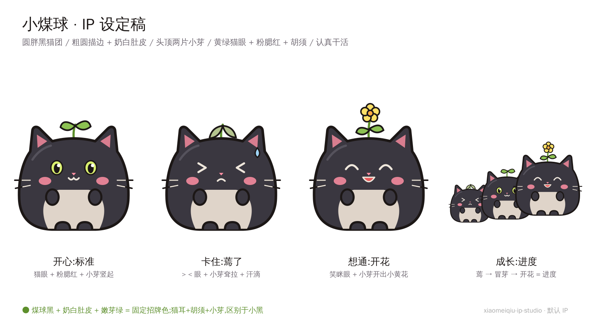
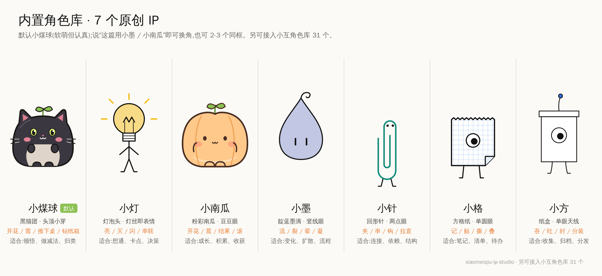
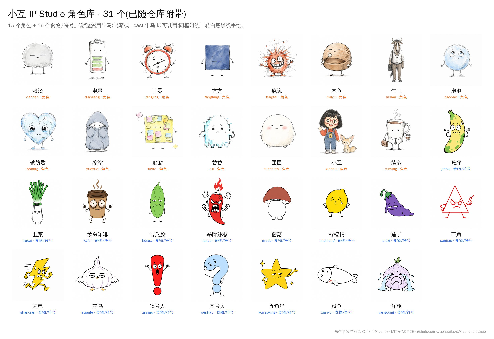
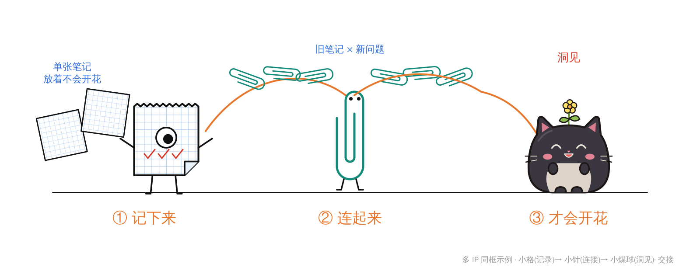

# 小煤球 IP Studio · 拆解式配图

> 小黑的拆法(怎么拆) + 小互的工具箱(拆得全、画得准、生得出) + 原创 IP 小煤球(谁来演)。

一个给 AI agent(Claude Code / Codex / Copilot 等)用的中文正文配图技能,融合了:

- [helloianneo/ian-xiaohei-illustrations](https://github.com/helloianneo/ian-xiaohei-illustrations):怪诞手绘风格、**认知锚点 → shot list → 原创隐喻**的拆解方式(小黑方法)。
- [xiaohuailabs/xiaohu-ip-studio](https://github.com/xiaohuailabs/xiaohu-ip-studio):逐节枚举、深层提炼、三轨分流、隐喻对照、比例规则、生图脚本、角色库。

## 它做什么

1. **像小黑一样拆解**:读透文章 → 定全文主张 → 逐节判“配 / 不配” → 挑认知锚点 → 每张图写出灵魂话、小煤球动作、隐喻对照和必现内容 → 输出一份配图拆解方案。
2. **按需生成**:你说“生成”,它直接按方案逐张出图(小煤球出演,纯白手绘、少量红橙蓝批注、大量留白)。
3. **自检迭代**:按 QA 清单检查选点、机制准确性、小煤球是否在干活、是否像 PPT。

## IP:小煤球



一只**圆滚滚的小黑猫团**:奶白肚皮、黄绿猫眼、粉腮红、胡须,头顶两片小绿芽。**小芽和表情就是状态**——想通就开花、卡住就蔫、拿不准就折一只耳朵。会把没用的推下桌、钻纸箱归类、理毛线、用毛线把东西串起来、一排小芽依次长大标进度。软萌但认真:可爱但不幼稚、不贴纸化、不卖萌摆拍。完整设定见 `references/xiaomeiqiu-ip.md`。

## 角色库



7 个内置原创角色(小煤球为默认),同一画风,说“这篇用小墨出演”即可换角,拆解方法不变:

| 角色 | 外形 | 动作 | 适合 | 设定稿 |
|---|---|---|---|---|
| **小煤球**(默认) | 圆胖小黑猫团,奶白肚皮,黄绿猫眼,头顶两片小绿芽 | 开花 / 蔫 / 推下桌 / 钻纸箱 / 理毛线 / 扑 | 想通、卡点、做减法、归类、进度 | [sheet](assets/xiaomeiqiu-sheet.png) · [spec](references/xiaomeiqiu-ip.md) |
| **小灯** | 灯泡头细线小人,无眼无嘴,灯丝即表情 | 亮 / 灭 / 闪 / 串联 / 接线 / 调光 | 想通、卡点、决策、进度 | [sheet](characters/xiaodeng/sheet.png) · [spec](characters/xiaodeng/character.md) |
| **小南瓜** | 矮胖橙南瓜,深棕粗描边,两片小芽,豆豆眼 + 腮红 | 开花 / 蔫 / 藤蔓结果 / 滚 / 开盖撒种子 | 成长、积累、收获、播种 | [sheet](characters/xiaonangua/sheet.png) · [spec](characters/xiaonangua/character.md) |
| **小墨** | 空心水滴 + 淡靛蓝晕染,竖线眼,无腿 | 流 / 分裂 / 合流 / 晕开 / 凝固 / 干涸 | 变化、扩散、流程 | [sheet](characters/xiaomo/sheet.png) · [spec](characters/xiaomo/character.md) |
| **小针** | 青绿色回形针身,两点眼,无手臂 | 夹 / 串 / 钩 / 拉直 / 弯折 / 撑 | 连接、依赖、结构 | [sheet](characters/xiaozhen/sheet.png) · [spec](characters/xiaozhen/character.md) |
| **小格** | 白底淡蓝方格纸,顶边撕口,单圆眼 | 记 / 贴 / 撕 / 折 / 叠 / 对齐 | 笔记、清单、待办 | [sheet](characters/xiaoge/sheet.png) · [spec](characters/xiaoge/character.md) |
| **小方** | 白色正面纸盒,单圆眼,蓝点天线 | 吞 / 吐 / 封 / 分装 / 塞爆 / 叠 | 收集、归档、分发 | [sheet](characters/xiaofang/sheet.png) · [spec](characters/xiaofang/character.md) |

### 接入小互 IP Studio 的 31 个角色



[小互 IP Studio](https://github.com/xiaohuailabs/xiaohu-ip-studio) 的 31 个角色**已随仓库附带**(`cast-xiaohu/`:角色包 + 1024px 参考图,© 小互,按其 MIT + NOTICE 转载),克隆下来就能用:

```bash
python3 scripts/studio.py cast list         # 38 个角色,按来源分组
python3 scripts/studio.py cast show 牛马     # 角色包 + 参考图路径
python3 scripts/studio.py cast install      # 可选:拉上游最新版 / 原尺寸图到 vendor/
```

- 角色(15):淡淡、电量、丁零、方方、疯崽、木鱼、牛马、泡泡、破防君、缩缩、贴贴、替替、团团、小互、续命
- 食物 / 符号(16):蕉绿、韭菜、续命咖啡、苦瓜脸、暴躁辣椒、蘑菇、柠檬精、茄子、三角、闪电、蒜鸟、叹号人、问号人、五角星、咸鱼、洋葱

接入后统一用本技能的白底黑线画风,每个角色只保留一点淡主色。38 个角色的肢体、招牌色、擅长主题和推荐组合见 [`references/cast-roster.md`](references/cast-roster.md)。

## 多 IP 同框:一篇文章用 2-3 个角色



文章本身有多个角色或视角时(人 vs AI、旧 vs 新、多环节流水线),可以定一张**演员表**:1 个主角 + 1-2 个搭档。每个角色代表一个全篇不变的意思,比如小格 = 记录、小针 = 连线、小煤球 = 洞见。

- 单张默认最多 2 个 IP;3 个只出现在交接图、四格和总览图里。
- 每个 IP 都要干活,不准有人站旁边围观。
- 招牌色不撞,外形不合体。
- 互动模式从五种里选:交接、对照、协作、冲突、因果。

对 agent 说「这篇用小格 + 小针 + 小煤球」即可。生图时用 `--cast` 按顺序附参考图:

```bash
python3 scripts/generate.py --prompt-file p.md --cast 小格 小针 小煤球 --out 03.png
```

完整示例(一篇示例文案、拆解方案和 prompt)见 [`examples/ensemble-demo.md`](examples/ensemble-demo.md),规则见 [`references/ensemble.md`](references/ensemble.md)。

## 两种用法

| 你说 | 它做 |
|---|---|
| “帮我拆解这篇的配图方案” / “分析哪里需要配图” | 只输出拆解方案(逐节判定 + shot list),停下 |
| “给这篇生成配图” / “帮我做图” | 内部拆解后直接逐张生成并交付 |

## 和两个原技能的区别

| | 小黑原版 | 小互原版 | 本技能 |
|---|---|---|---|
| 拆解口径 | 简洁、决断 | 详尽、多道闸门 | 小黑口径输出,小互闸门在草稿里跑 |
| 防漏配 | 凭判断挑锚点 | 逐节枚举 | 逐节枚举 + 锚点清单 |
| 防画错 | — | 深读 Q4 + 隐喻对照 | 保留 |
| 图类型 | 8 种结构 | 三轨 + 海报 | 10 种结构 × 三轨 + 可选海报 |
| 演员 | 小黑 | 31 个角色(需选) | 默认原创 IP 小煤球,38 个角色可换,一篇可用 2-3 个 IP |
| 生成前确认 | 不停 | 必停选角选风格 | 分析就停,生成就不停 |
| 比例 | 16:9 | 按内容形状,封顶 4:3 | 按渠道:桌面 16:9,移动端按形状 |
| 生图 | 内置 `image_gen` | 自带脚本 | 内置工具优先,脚本兜底,另加比例校验与 `--dry-run` |

## 安装

```bash
git clone https://github.com/wbin888/xiaodeng-ip-studio ~/.claude/skills/xiaomeiqiu-ip-studio
cd ~/.claude/skills/xiaomeiqiu-ip-studio && bash install.sh                 # 加 --with-xiaohu 可额外拉取上游最新版小互角色库
```

只做分析、或 agent 自带生图工具时,不需要配置 API key。

## 目录

```text
SKILL.md                     流程骨架
references/
  analysis-playbook.md       拆解方法本体
  plan-template.md           方案输出格式 + 示例
  metaphor-method.md         现编隐喻 + 对照表 + 反复刻
  xiaomeiqiu-ip.md           小煤球 IP + 嵌入法则
  style-dna.md               风格、颜色语义、比例
  tracks.md                  情绪 / 解释 / 四格 / 海报
  prompt-template.md         各轨 prompt 骨架
  qa-checklist.md            自检与迭代
  cast-roster.md             38 个角色速查 + 推荐组合
  ensemble.md                多 IP 同框规则
  cast-swap.md               换角操作与角色包安全
  backends.md                生图后端
characters/<id>/             内置换角:character.md + sheet.png(xiaodeng 小灯 / xiaonangua 小南瓜 / 小墨 / 小针 / 小格 / 小方)
assets/                      小煤球设定稿、角色库总览图、多 IP 示例图
examples/ensemble-demo.md    3 个 IP 的完整示例(文案 + 方案 + prompt)
cast-xiaohu/                 小互 31 个角色(character.md + 1024px 参考图 + 原 LICENSE/NOTICE)
vendor/                      cast install 拉取的上游完整版(可选,不入库)
scripts/
  generate.py                生图(OpenAI 兼容端点,纯标准库)
  studio.py                  init / doctor / cast list·show·install
  castlib.py                 统一角色注册表(内置 + 小互)
agents/openai.yaml           Codex agent 元数据
```

## 换角

默认小煤球。想换内置角色,直接说“这篇用小灯 / 小南瓜 / 小墨 / 小针 / 小格 / 小方出演”。想让小互角色出演,直接说“这篇用牛马出演”。想同时用多个角色,说“这篇用小煤球 + 替替”。详见 `references/cast-swap.md` 和 `references/ensemble.md`。

## 许可与署名

MIT。小煤球、小灯、小南瓜、小墨、小针、小格、小方均为本技能原创 IP;拆解方法源自 Ian 小黑;小互角色与画风 © 小互(`cast-xiaohu/` 按其 MIT 转载,保留原 LICENSE 与 NOTICE)。详见 `NOTICE.md`。
