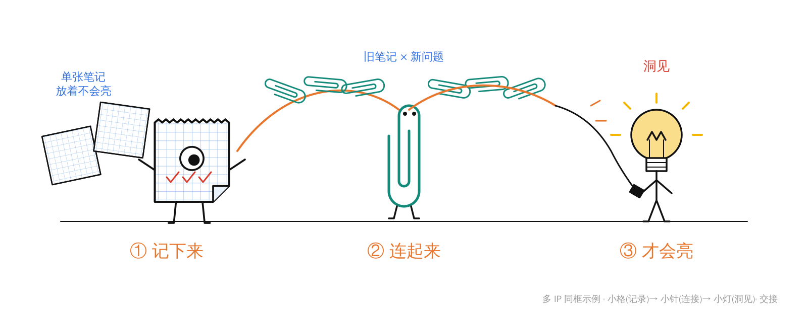

# 示例:一篇文章同时用 3 个 IP

这份示例分三部分:

- **一篇示例文案**(原创,可直接拿来试)
- **完整的配图拆解方案**:演员表 3 个 IP,再加 1 个小互龙套
- **一张多 IP 同框图的完整 prompt 与生图命令**

---

## 一、示例文案

> **记了 3000 条笔记,为什么还是想不出东西**
>
> **一、收藏夹里的坟场**
>
> 我曾经很骄傲:三年,3000 条笔记,金句、文章、灵感,看到就记。直到有一天要写一篇稿子,我打开笔记库,翻了半小时,一条也用不上。最后叹了口气——算了,还是从零开始写吧。
>
> **二、笔记不是存款,是零件**
>
> 问题不在记得少。单独一条笔记就像一个零件,放在抽屉里永远只是零件。存款会自己生利息,零件不会。
>
> 真正有用的笔记库,不看你存了多少条,而看条和条之间**连了多少根线**。
>
> **三、记下来 → 连起来 → 才会亮**
>
> 我现在的做法只有三步:
>
> 1. **记下来**:只记自己的一句话,不抄原文。
> 2. **连起来**:每记一条新的,就去找一条旧的,写下“它们为什么有关”。
> 3. **才会亮**:写作时不再搜关键词,而是顺着连线走,走到某个交叉口,观点自己就冒出来了。
>
> **四、一个月后**
>
> 第一周很别扭,每条都要想“它跟谁有关”。第二周开始,我发现一条三年前的读书笔记,和昨天的一个会议吐槽能连上。第四周,我写稿时第一次没有打开搜索框。
>
> **五、给你的建议**
>
> 别再比谁记得多。今天就挑一条旧笔记,给它找一个新邻居。

---

## 二、配图拆解方案

```markdown
## 配图拆解方案:记了 3000 条笔记,为什么还是想不出东西

**全文主张**:笔记的价值不在条数,在连线;记下来、连起来,才会亮。
**建议张数**:4 张(情绪 1 / 解释 2 / 四格 1)
**一篇一世界**:不启用(三个角色本身就是「纸 / 回形针 / 灯」这一套文具世界)
**演员表**:多 IP(文章本身就是三段流水线,每段性质不同 → 过 ensemble 判定)

| 角色 | 身份 | 代表(全篇不变) | 出场 |
|---|---|---|---|
| 小格 | 主角 | 一条笔记 / 记录 | 01 02 03 04 |
| 小针 | 搭档 | 笔记之间的连线 | 02 03 04 |
| 小灯 | 搭档 | 洞见 / 写作时冒出的观点 | 03 04 |
| 蒜鸟(小互) | 龙套 | 「算了」 | 01 |

### 逐节判定
| 小节 | 信号 | 判定 | 理由 |
|---|---|---|---|
| 一、收藏夹里的坟场 | 情绪 | 配·情绪 | 开头钩子:「记了很多却用不上」要让读者代入 |
| 二、笔记不是存款,是零件 | 对比 | 配·解释 | 存 vs 连,是全文最反直觉的判断 |
| 三、记下来 → 连起来 → 才会亮 | 流程 | 配·解释 | 全文 hero,三步要数着记 |
| 四、一个月后 | 时间线 | 配·四格 | 有起承转合 |
| 五、给你的建议 | 行动号召 | 不配 | 一句话,文字已经足够 |

### Shot list

#### 01 · 收藏夹里的坟场
- **位置**:第一节末(「还是从零开始写吧」后)
- **核心意思**:记得越多,越用不上
- **图类型 / 结构**:情绪 / 处境
- **出演**:小格(被压在一座方格纸山的最底层,只露出一只眼)→ 蒜鸟(在山脚摊开翅膀转身离开)· 因果
- **建议元素**:一座歪斜的方格纸山、一个「3000」的小纸牌
- **中文标注**:3000 条 / 找不到 / 算了
- **比例 · IP 占比**:1:1 · 小格极小,蒜鸟 ~12%

#### 02 · 存款 vs 零件
- **位置**:第二节「连了多少根线」后
- **核心意思**:不是存得多,是连得多
- **图类型 / 结构**:解释·对比 / 左右对照
- **出演**:左边,小格(和一堆零散的方格纸一起被锁进抽屉,抽屉标着「+1」)| 右边,小针(把三张方格纸夹成一张网)· 对照
- **隐喻对照**:抽屉 → 只收藏的笔记库;小针串起的网 → 有连线的笔记库
- **必现内容**:左边写「条数」,右边写「连线」;右边恰好 3 张纸、3 根连线
- **建议元素**:带锁的抽屉、三张方格纸
- **中文标注**:存了 3000 条 / 连了 3 根线 / 零件 / 网
- **比例 · IP 占比**:16:9 · 合计 ~25%

#### 03 · 记下来 → 连起来 → 才会亮(hero)
- **位置**:第三节三步列表后
- **核心意思**:一条笔记不会亮,连上了才会亮
- **图类型 / 结构**:解释·流程 / Workflow
- **出演**:小格(记满对勾,站在起点)→ 小针(作为一串回形针里唯一活着的那一环,把旧笔记和新问题钩在一起)→ 小灯(手里握着链条末端的插头,亮了)· 交接
- **隐喻对照**:方格纸 → 一条笔记;回形针链 → 笔记间的连线;插头接通 → 写作时顺着连线走到观点
- **必现内容**:三步,顺序是 记下来 → 连起来 → 才会亮;「旧笔记 × 新问题」
- **建议元素**:回形针链、插头
- **中文标注**:① 记下来 / ② 连起来 / ③ 才会亮 / 旧笔记 × 新问题 / 洞见
- **比例 · IP 占比**:16:9 · 三个合计 ~30%(三人同框:交接图,允许)

#### 04 · 一个月后
- **位置**:第四节末
- **核心意思**:连线是慢慢长出来的,长到某天,不用搜索了
- **图类型 / 结构**:四格
- **出演**:每格最多 2 个 IP,主线由小格贯穿
  - 起:小格皱着眉,对着一张旧纸,不知道该连谁。小灯灭着。
  - 承:小针一端钩住「三年前的读书笔记」,另一端钩住「昨天的会议吐槽」,两张纸都很意外。
  - 转:回形针链越来越长,小格站在链条中间的一个交叉口上。
  - 合:小灯合上了搜索框的盖子,它自己亮着。
- **中文标注**:第一周 / 第二周 / 第三周 / 第四周
- **比例 · IP 占比**:1:1 · 每格小

### 稳 / 可选
- 最稳:03——三人交接的结构就是全文主张,删了这张,读者记不住三步。
- 最稳:02——反直觉判断,需要一张图来翻转认知。
- 可选:04——四格节奏好,但如果版面紧,可以删。
```

**分布检查**(`ensemble.md`):

| 检查项 | 结果 |
|---|---|
| 主角小格出场 | 4 / 4 |
| 搭档小针出场 | 3 次 |
| 搭档小灯出场 | 2 次 |
| 三人同框 | 只在 03(交接图) |
| 小互龙套 | 只在 01 出场,不进主线 |
| 招牌色 | 淡蓝方格、青绿、暖黄、蒜白淡紫,互不相撞 |

> 示例里主角是小格,不是小灯:选角跟着文章走,默认主角也可以让位。

---

## 三、03 号图的 prompt

示意草图(不是生图结果,只用来说明构图):



`prompts/03.md`:

```text
---
aspect_ratio: "16:9"
---
Generate one standalone 16:9 horizontal Chinese article explanatory sketch (FLOW), hand-drawn, NOT a slide.

Visual DNA:
Pure white background. Minimalist black hand-drawn line art. Slightly wobbly pen lines. Lots of empty white space. Sparse red/orange/blue handwritten Chinese annotations. Clean absurd product-sketch feeling. No gradients, no shadows, no paper texture, no complex background, no commercial vector style, no PPT infographic look, no cute mascot poster, no children's illustration, no realistic UI.

Recurring IP characters required (3 different characters — keep them visually distinct, NEVER merge their features or swap their parts):

Character 1 — 小格 (Xiaoge): a single square sheet of GRID PAPER torn from a spiral notebook. White paper, thin black hand-drawn outline, LIGHT BLUE grid lines; jagged torn top edge; bottom-right corner folded inward. NOT a yellow sticky note. ONE large round eye (white with a black pupil), no mouth. Two thin stick legs, thin line arms when needed.
Character 2 — 小针 (Xiaozhen): a single TEAL-GREEN double-loop paperclip standing upright, one continuous teal line, no fill, no shine. Two small black dot eyes inside the top of the outer loop, no mouth. Two short thin black legs; NO arms.
Character 3 — 小灯 (Xiaodeng): a thin stick figure whose head is a round LIGHT BULB with a small white screw base. NO eyes, NO mouth — its only face is the filament. Lit = filament stands up as a sharp "M" zigzag, translucent warm yellow inside the bulb, a few short yellow rays.

Who does what in this image (handoff):
- 小格: stands at the far left, its grid filled with three small red check marks, with two plain grid sheets scattered behind it.
- 小针: in the middle, the ONLY living link in a chain of plain teal paperclips; the chain arcs from 小格 on the left to the right, hooking "old notes" to "new question".
- 小灯: at the far right, holding the plug at the end of the chain in one hand; it is LIT.
Every character performs a different part of the core action; nobody stands aside watching. All characters are small (together about 30% of the frame) and drawn with the SAME black pen as the rest of the scene.

Core idea: one note never lights up; connected notes do.
Flow: left → right; one orange arc runs along the paperclip chain from 小格 to 小灯.
Chinese handwritten labels (exact text): ① 记下来 / ② 连起来 / ③ 才会亮 / 旧笔记 × 新问题 / 洞见

Color use:
Each character keeps ONLY its own signature color: 小格 = light blue grid lines; 小针 = teal-green wire; 小灯 = warm yellow inside the bulb only. No character borrows another's color. Orange for the main flow arc and step labels. Red only for the check marks and "洞见". Blue only for the small note "旧笔记 × 新问题". Color names are rendering guidance only — do NOT display them as visible text.

Body integrity:
小格 is exactly one grid sheet with one eye and two legs, never yellow. 小针 is exactly one teal paperclip with two dot eyes and two legs, no arms; the other paperclips in the chain are plain (no eyes, no legs). 小灯 has exactly one bulb head, one screw base, one line body, two arms, two legs, no eyes or mouth. Background lines stop at each character's outline.

Constraints:
Exactly three steps, in this order. Keep ≥35% blank white space. No title in the top-left corner. Do not write the structure type. Strange but clean, not childish.
```

生图:

```bash
python3 scripts/generate.py --prompt-file prompts/03.md --cast 小格 小针 小灯 --out assets/notes-illustrations/03-connect-to-light.png
```

`--cast` 会按顺序附上三张设定稿,并在 prompt 末尾追加:

```text
Reference images: image 1 is the character sheet of 小格 (Xiaoge) — copy its look exactly; image 2 … 小针 …; image 3 … 小灯 …. Keep every character visually distinct; never merge their features.
```

01 号图换成 `--cast 小格 蒜鸟`(仓库已自带蒜鸟,无需安装)。蒜鸟会按线稿锚点转成白底黑线,只保留一点淡紫。
